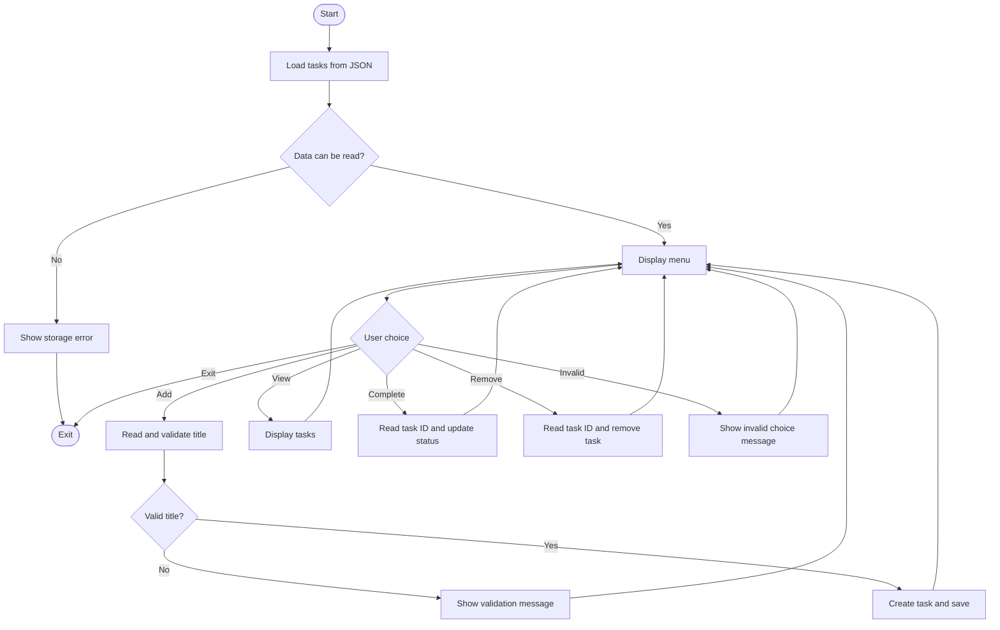

# To-Do List Manager (Python CLI)

A command-line To-Do List Manager built with Python. It lets you add tasks, view the task list, mark tasks as completed, and remove tasks. Tasks are stored locally in a JSON file and remain available after the application is closed.

## Requirements

- Python 3.10 or newer
- No third-party packages are required.

Check your Python version with:

```bash
python --version
```

On some systems, use `python3` instead of `python`.

## Project structure

```text
python-cli-todo-manager/
├── main.py
├── README.md
├── requirements.txt
├── .gitignore
├── todo_app/
│   ├── __init__.py
│   ├── __main__.py
│   ├── cli.py
│   ├── manager.py
│   ├── models.py
│   └── storage.py
└── tests/
    ├── __init__.py
    ├── test_manager.py
    └── test_storage.py
```

The `data/tasks.json` file is created automatically when the first task is saved. It is excluded from version control so personal task data is not committed.

## Design

The program is split into modules so that each part has a clear responsibility:

| Module | Responsibility |
|---|---|
| `models.py` | Defines the `Task` data class and its JSON conversion. |
| `storage.py` | Reads and writes task data in JSON format. |
| `manager.py` | Handles adding, listing, completing, and removing tasks. |
| `cli.py` | Displays the menu, accepts input, and shows results. |
| `main.py` and `__main__.py` | Start the application. |

The `Task` class represents an individual task. `TaskManager` handles task operations. Keeping file storage separate from the menu makes the task logic easier to test.

JSON was selected because it is readable and supported by Python's standard library. Each task has a positive numeric ID, a title, a completion status, and a creation timestamp. New IDs are based on the largest existing ID, so an ID is not reused after a task is removed.

The storage module writes changes to a temporary file before replacing the saved file. It also reports malformed or unreadable saved data rather than silently replacing it with an empty list.

## Run the application

1. Download or clone this repository.
2. Open a terminal in the project folder.
3. Run:

```bash
python main.py
```

You can also use:

```bash
python -m todo_app
```

No installation command is needed because the application uses only the Python standard library.

## Menu

When the program starts, it displays these options:

1. Add a task
2. View all tasks
3. Mark a task as completed
4. Remove a task
5. Exit

Enter the number for the action you want to perform. When completing or removing a task, use the ID displayed in the task list.

## Application flow



### Pseudocode

```text
START
    LOAD saved tasks
    REPEAT
        DISPLAY menu
        READ choice

        IF choice is Add:
            READ and validate title
            CREATE task with a new ID
            SAVE tasks
        ELSE IF choice is View:
            DISPLAY all tasks and their status
        ELSE IF choice is Complete:
            READ and validate task ID
            MARK matching task as completed
            SAVE if the task exists
        ELSE IF choice is Remove:
            READ and validate task ID
            REMOVE matching task
            SAVE if the task exists
        ELSE IF choice is Exit:
            STOP
        ELSE:
            DISPLAY an error message
    UNTIL the user exits
END
```

## Input validation and error handling

- Empty task titles are rejected.
- Titles longer than 100 characters are rejected.
- Task IDs must be positive whole numbers.
- An ID that does not match a task produces a message and returns to the menu.
- Invalid menu choices do not stop the application.
- A missing task file is treated as an empty task list.
- Invalid JSON and malformed task records produce a storage error. Existing data is not overwritten automatically.
- File save errors are reported to the user.

## Automated tests

Run the tests from the project folder:

```bash
python -m unittest discover -s tests -v
```

The tests use temporary files and folders. They do not modify the task list used by the application.

The test suite covers task creation, title and ID validation, completing and removing tasks, ID generation, saving and loading, persistence after reopening the manager, and invalid JSON data.

## Manual test scenarios

| Scenario | Steps | Expected result |
|---|---|---|
| Add a task | Choose option 1 and enter a title. | The task is saved with a new ID and Pending status. |
| View tasks | Choose option 2. | All saved tasks and their statuses are displayed. |
| Complete a task | Choose option 3 and enter an existing ID. | The selected task is marked Completed. |
| Remove a task | Choose option 4 and enter an existing ID. | The selected task is removed. |
| Empty title | Choose option 1 and press Enter without typing. | A validation message appears and no task is added. |
| Invalid ID | Enter letters instead of a number when asked for an ID. | The input is rejected and the menu remains available. |
| Unknown ID | Enter an ID that is not in the list. | A task-not-found message appears. |
| Check saved data | Add a task, exit, and start the program again. | The task is still in the list. |
| Invalid menu option | Enter a number outside the menu options. | An error message appears and the menu is displayed again. |

## Notes

The project contains the application source code, README, and automated tests. The task data file is created locally at runtime and is not included in the repository.
